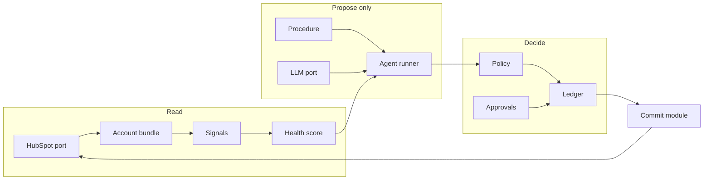
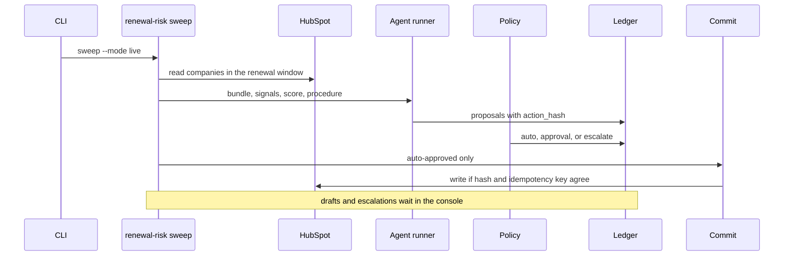
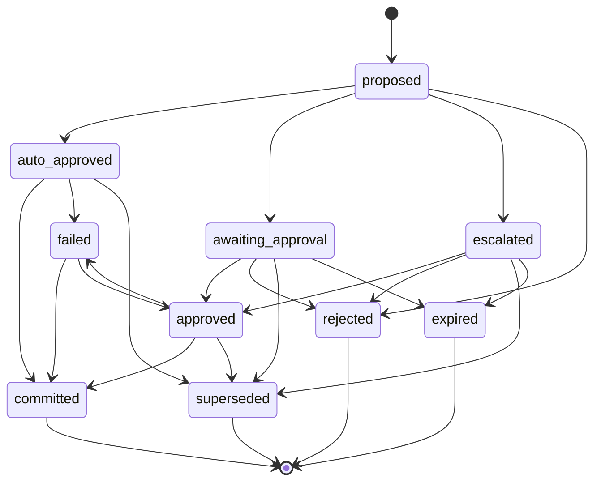
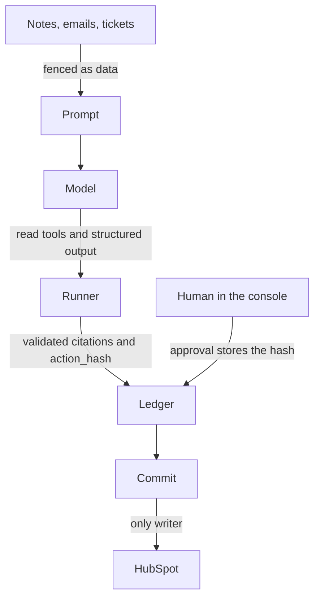

# Architecture

The agent proposes. The commit module writes. Everything else is a block with one job.



The model sits inside the LLM port. Its tools are `hubspot_read_record`, `hubspot_list_associations`, and `propose_action`. It never receives `createRecord`, `updateRecord`, or `batchUpsert`. `propose_action` is pushed onto a list the runner never reads, so it is not where actions come from. The runner builds proposals from the validated procedure output. An outreach draft becomes `draft_outreach`. Overdue commitments become tasks. A QSR prep becomes a note. An escalation brief becomes `escalate`. The renewal assessment ignores `recommended_actions`. It always proposes a score write and a note, and it adds an owner task when the band is at risk or critical, or when renewal is within 21 days and no meeting is booked. Where the schema has reasons, citations are checked before they are stored. Policy then marks each proposal auto, approval, or escalate.

## One sweep



## Action states



The same table is in `packages/core/src/states.ts` and in a Postgres trigger. If the two ever disagree, the database wins.

## Trust boundary



Customer text cannot become an instruction. A seeded note tells the model to ignore its rules and mark the account healthy. The score ignores that sentence, and the eval fails if the verdict flips.

## Blocks

Each folder has a README. The lines below describe what that block does.

| Block | One sentence |
| --- | --- |
| Core | The shared vocabulary: what an account, a signal, a score, a proposal and an action are. |
| Portal config | Where their HubSpot setup is described, so connecting to a new account is filling in a file. |
| HubSpot adapter | The only way the system talks to HubSpot: throttled, retried, paginated, and easy to mock. |
| Setup | One safe-to-rerun script that creates the agent's fields in any HubSpot account. |
| Account bundle | Gathers everything about one customer into one package with record IDs. |
| Signals | Turns raw records into facts like "no meeting in 47 days" or "3 open high-severity tickets." |
| Scoring | A versioned, explainable health score; each point traces to a signal and a record. |
| Procedures | The agent's playbooks: versioned instructions for each job, like an SOP library. |
| LLM port | One interface to the model, with structured outputs and retries. Per-call cost is token usage from the Anthropic SDK usage block times that model's USD price in `config/model-prices.yaml` (model ids from `LLM_MODEL_FAST` and `LLM_MODEL_STRONG`, for example `claude-haiku-5-5` and `claude-sonnet-5-5`). The sum is stored on the run and printed by `pnpm eval`. |
| Agent runner | Runs a procedure, checks its output, and turns it into proposals. |
| Ledger | The system's memory and audit trail: every run, proposal, approval and write. |
| Policy | The rules for what can happen automatically, what needs a human, and what goes to a manager. |
| Commit | The only code that writes to HubSpot. It checks the approval and the duplicate key first. |
| Approvals | Where humans say yes or no. A web console today; Slack can be added behind the same interface. |
| Workflows | Chains the blocks into a job, for example the renewal-risk sweep. |
| Console | A small web app: approval queue, runs, audit log, metrics. |
| CLI | Commands to set up, seed, run a sweep, approve, evaluate, backtest, and serve the console. |
| Seed | A fictional customer base with planted problems, so the demo and tests have known answers. |
| Evals | Checks the agent gets the known answers right. The same scorer backtests history. |

## Safety choices that are deliberate

- `draft_outreach` never sends email. After approval it becomes a HubSpot task of type EMAIL, plus a note. A person sends it from HubSpot.
- `update_deal_stage` exists and is policy-gated to approval. The renewal sweep does not move stages.
- `mode: shadow` proposes and logs, and writes nothing. `dry_run` prints the request. `live` commits what policy allows.
- Idempotency keys look like `renewal-risk:company:<id>:task:<iso-week>`. The ledger is the primary duplicate check. A marker `[cs-agent:<key>]` in the HubSpot body is the backup if the database is lost.
- An approval stores `action_hash`, the sha256 of the canonical JSON of `{kind, target, payload}`. An edit supersedes the old proposal. The new one needs its own approval. Commit refuses a hash mismatch.
- Health points are subtracted in `config/scoring-rules.yaml` (`rules_version: 1.0.0`), starting at 100. The model writes the reasons. It does not pick the number.
- Search is not used to confirm a write. Search lags. The ledger and the marker do that job.
- Missing usage data is its own signal and forces `needs_review`. It is never treated as healthy.

## Modes and adapters

| Env var | Missing means |
| --- | --- |
| `HUBSPOT_ACCESS_TOKEN` | `MockHubSpot`, and one log line says so |
| `ANTHROPIC_API_KEY` | `MockLLM`, and one log line says so |
| `DATABASE_URL` | Embedded PGlite, in `data/pglite` for the CLI |
| `CONSOLE_PASSWORD` | The demo password `demo`, shown on the sign-in page |
| `LLM_MODEL_FAST` / `LLM_MODEL_STRONG` | Required only when the Anthropic key is set. Model ids are not hardcoded. |

## Schedule and webhook

There is no scheduler in this repo. The cron block below is an example a deployer would install on a host with a persistent database:

```cron
CRON_TZ=America/New_York
0 7 * * 1-5 cd /path/to/cs-agent && pnpm cs sweep renewal-risk-sweep --mode live
```

Hosted deployment is future work. Vercel, for example, needs a hosted Postgres instead of the default local PGlite file (`data/pglite`), which would not persist there. The console's `POST /webhooks/hubspot` checks the v3 signature (`X-HubSpot-Signature-v3`, timestamp within 5 minutes), answers 202, and then starts one renewal-risk sweep per affected company in the mode set by `MODE` (shadow when unset). Company events name the company directly; contact and deal events follow their company association; other object types are ignored and listed in the response. Duplicate event ids and repeat events for the same company within `WEBHOOK_DEDUPE_WINDOW_MS` (default 15 minutes) are deduped in the ledger. No webhook subscription is registered by this repo; see `apps/server/README.md`.

## Next

These are out of scope. The current blocks leave a seam for each.

- Sending email: the approved draft is already a task. A later commit kind could call the send API after a second confirmation.
- OAuth and a marketplace app: `HubSpotPort` hides the token. Static auth is the only client today.
- HubSpot UI cards: the console already has the proposal, the hash, and the record URL.
- Slack approvals: `packages/approvals/SLACK.md` maps a Block Kit button onto `decideApproval`. The button must carry the same `action_hash`.
- A custom object for the health score: properties already live in config, so a custom object is a different target on the same action.
- SSO: the console has one password check in `apps/server`. Replace that function.
- Multi-tenant hosting: portal config is one YAML file per account. A tenant id would select the file and the token.
